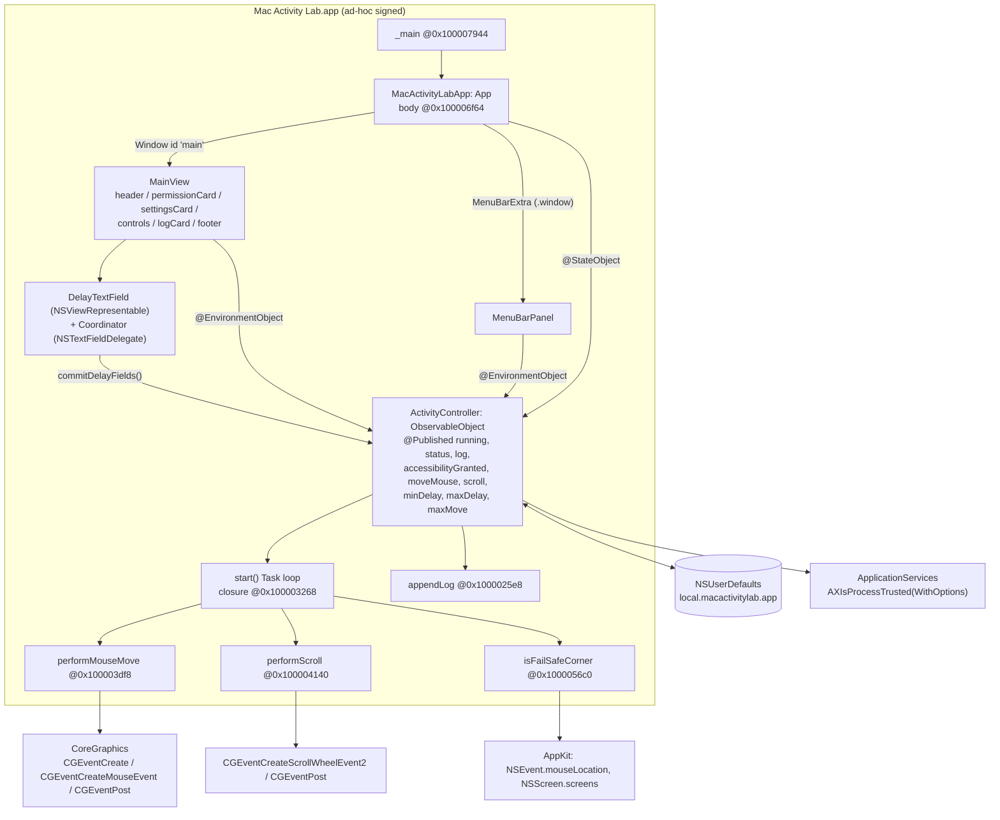

# Architecture: Mac Activity Lab V5

## How to read the citations

There's no source code in this target, only a compiled, unstripped Swift binary. Citations use these forms:

- `BIN @ 0x1000xxxxx` is a virtual address in `Mac Activity Lab.app/Contents/MacOS/MacActivityLab`. Line numbers don't exist in a binary, so addresses replace them.
- `Info.plist:N` is a line in `Mac Activity Lab.app/Contents/Info.plist`.
- `DMG` is `MacActivityLab-V5-macOS-AppleSilicon.dmg`. It's still at the repo root; it belongs in `target/`.

Swift names below are demangled by hand. The mapping to the raw mangled symbols is in `notes/renames.md`.

Extraction is reproducible and was done without mounting anything. `DMG` is a UDIF image (zlib chunks). Its APFS partition #4 ("disk image") was unpacked with a custom blkx parser plus `7z` 23.01.

| Item | Value |
|---|---|
| DMG sha256 | `c1436cf7382b929c2507ac77288c6871bbab2e755b8c3ea7861a45c15dfde491` (CONFIRMED) |
| APFS volume name | `Mac Activity Lab V5`, formatted 2026-10-18 (CONFIRMED, `7z l`) |
| Volume contents | `Mac Activity Lab.app` (Info.plist, CodeResources, one executable) plus an `Applications` symlink for drag-to-install (CONFIRMED) |
| Executable sha256 | `e00e5f0630635f3b10435abc10a6671ea244dbf1de8840f113d830624c14b1cd`, Mach-O arm64, 422,736 bytes (CONFIRMED) |
| Toolchain | Swift 6.2 / Xcode toolchain path in strings, SDK and min OS 13.0 (CONFIRMED, `LC_BUILD_VERSION`; `Info.plist:20-21`) |

---

## 1. What it does (3 sentences)

Mac Activity Lab is a macOS menu-bar utility (SwiftUI + CoreGraphics, Polish UI) that simulates user presence. It moves the mouse cursor by a random offset and/or scrolls the active window by a random number of lines, at random intervals between a configurable minimum and maximum delay. It needs the macOS Accessibility permission to inject these synthetic events, keeps its settings in `UserDefaults`, and stops automatically when the user pushes the cursor into the top-left corner of the screen (a "fail-safe").

CONFIRMED by: cstrings `BIN @ 0x100017cb0` ("Losowy ruch kursora" = random cursor movement), `@ 0x100017cd0` ("Losowe przewijanie aktywnego okna" = random scrolling of the active window), `@ 0x100017c00` (fail-safe text), and imports `CGEventCreateMouseEvent`, `CGEventCreateScrollWheelEvent2`, `CGEventPost`, `AXIsProcessTrusted[WithOptions]`.

GUESS: the purpose is to keep "active / away" status alive in chat or monitoring tools, or to stop the screen from locking. That's the typical use of a mouse jiggler, but nothing in the binary says so.

---

## 2. Entry points

| # | Entry point | Location | Notes |
|---|---|---|---|
| E1 | Process entry `LC_MAIN` → `_main` | `BIN @ 0x100007944` (entryoff 31044 = 0x7944) | CONFIRMED. Calls the `App` conformance getter `@ 0x100007950`, then `SwiftUI.App.main()` `@ 0x100007964`. This is the `@main struct MacActivityLabApp`. |
| E2 | `MacActivityLabApp.body` (Scene builder) | `BIN @ 0x100006f64` | CONFIRMED. Builds a `_TupleScene` of (a) `Window("Mac Activity Lab", id: "main")` containing `MainView`, with `defaultSize(590×610)` `@ 0x100007220`/`0x100007278`; and (b) `MenuBarExtra` with `MenuBarPanel` and `.menuBarExtraStyle(.window)` `@ 0x10000733c`/`0x1000073a4`. The window id is decoded as `"main"` from immediates `@ 0x100007218`; the id itself is a GUESS. |
| E3 | Agent-app flag | `Info.plist:22-23` (`LSUIElement = true`) | CONFIRMED. No Dock icon; the menu-bar item is the primary UI. |
| E4 | `ActivityController.init()` | `BIN @ 0x100001cdc` | CONFIRMED. Created once as a `@StateObject` and injected into both scenes via `.environmentObject` (`EnvironmentKeyWritingModifier<ActivityController?>` `@ 0x1000071ec`, `0x100007304`). |
| E5 | UI action handlers (button closures) | `MainView.permissionCard` closures `@ 0x10000a8b0`; `MainView.controls` `@ 0x10000c648…`; `MenuBarPanel.body` closures `@ 0x1000109b8`, `0x100010bc0`, `0x100010d8c` | CONFIRMED that they exist (`ScMYcc` = `@MainActor` closures). Their mapping to specific buttons (Start / Stop / Settings / Quit) is a GUESS based on the strings and the `gearshape` SF Symbol `@ 0x100010b08`. |
| E6 | `DelayTextField.Coordinator` (`NSTextFieldDelegate`) | `controlTextDidChange` `@ 0x100005fcc`, `controlTextDidEndEditing` `@ 0x10000616c`, `control:textView:doCommandBySelector:` `@ 0x100006430` | CONFIRMED. ObjC-callable delegate entry points invoked by AppKit. |
| E7 | Local `NSEvent` monitor | `DelayTextField.makeNSView` `@ 0x100005ad8`, `addLocalMonitorForEventsMatchingMask:2` `@ 0x100005c94`, handler `@ 0x100006b0c` | CONFIRMED mask = 2 = `NSEventMaskLeftMouseDown`, local only (the app's own windows). GUESS: it ends editing when the user clicks outside the field. |

There are no CLI handlers, servers, XPC services, launch agents or helpers. CONFIRMED: the volume holds one executable, and there are no `NSXPC`, `SMAppService` or socket imports.

---

## 3. Module diagram

---

## 4. The five main data flows

### Flow 1: Launch → settings load and seeding of defaults
1. `_main` → `SwiftUI.App.main()` `BIN @ 0x100007964`. CONFIRMED
2. `@StateObject` creates `ActivityController.init()` `@ 0x100001cdc`. CONFIRMED
3. `@Published` initial values: `running = false`; `status = "Zatrzymany"` ("Stopped", small-string immediates `@ 0x100001dfc-0x100001e10`); `log = []`; `accessibilityGranted = AXIsProcessTrusted()` `@ 0x100001e94`. CONFIRMED
4. `NSUserDefaults.standardUserDefaults` `@ 0x100001edc`. For each key, `objectForKey:` is called; if the value is nil, the default is written. CONFIRMED (the call pattern is repeated per key):

   | Key | Type | Default | Seeded at |
   |---|---|---|---|
   | `moveMouse` | Bool | `true` | `setBool:forKey:` `@ 0x100001fa0` (`w2 = 1` `@ 0x100001f98`) |
   | `scroll` | Bool | `true` | `@ 0x100002054` (`w2 = 1` `@ 0x10000204c`) |
   | `minDelay` | Double (s) | `8.0` | `setDouble:forKey:` `@ 0x100002108` (`fmov d0, #8` `@ 0x1000020fc`) |
   | `maxDelay` | Double (s) | `18.0` | `@ 0x1000021bc` (`fmov d0, #18` `@ 0x1000021b0`) |
   | `maxMove` | Double (px) | `80.0` | `@ 0x100002264-0x100002268` (`0x4054000000000000` = 80.0) |

5. The stored values are read back into the `@Published` properties. GUESS on the exact read-back order; the persisting setters are `moveMouse.setter` and the merged `minDelay.setter` thunk `@ 0x100001be0`.

### Flow 2: Accessibility permission request
1. The user clicks "Poproś o dostęp" ("Request access") in `MainView.permissionCard` (string `@ 0x100017e20`; closure `@ 0x10000a8b0`). The button-to-closure mapping is a GUESS.
2. `ActivityController.requestPermission()` `@ 0x10000247c` builds `[kAXTrustedCheckOptionPrompt: true]` (`@ 0x100002498`, dictionary literal `@ 0x100002504`). CONFIRMED
3. `AXIsProcessTrustedWithOptions(dict)` `@ 0x10000255c` makes macOS show the system prompt. CONFIRMED
4. `appendLog("Poproszono macOS o uprawnienie Dostępność.")` ("Asked macOS for the Accessibility permission") `@ 0x100002578`. CONFIRMED
5. `accessibilityGranted = AXIsProcessTrusted()` `@ 0x10000257c` → `@Published` setter `@ 0x1000025c4`. The UI then switches to "Dostępność jest włączona" ("Accessibility is on", `@ 0x100017ef0`). CONFIRMED for the call; the UI switch is a GUESS.
6. "Otwórz ustawienia" ("Open settings", `@ 0x100017f40`) is a second button. GUESS: it opens System Settings › Privacy › Accessibility via URL. I found no `NSWorkspace`/`openURL` import, so it may use SwiftUI's `openURL` environment value or `openWindow` instead.

### Flow 3: Start → main automation loop (the core)
1. A Start button calls `ActivityController.start()` `@ 0x100002974`. CONFIRMED
2. Guard: if `running` is already true, it returns (`tbnz` `@ 0x100002a1c`). If neither `moveMouse` nor `scroll` is on, the status becomes "Włącz ruch kursora lub scroll" ("Turn on cursor movement or scroll") and the log gets "Nie uruchomiono: żadna akcja nie jest włączona." ("Not started: no action is enabled.") (`@ 0x100017880`, `0x1000178a0`). CONFIRMED for the strings and branches; the exact pairing of each string with each branch is a GUESS.
3. Guard: `AXIsProcessTrusted()` `@ 0x100002abc`. If false: "Brak uprawnienia Dostępność" ("No Accessibility permission") / "Brak uprawnienia do sterowania komputerem." ("No permission to control the computer.") (`@ 0x1000178e0`, `0x100017900`). CONFIRMED
4. `normalizeSettings()` `@ 0x100002b5c` → `@ 0x100002f28` (see Flow 4). CONFIRMED
5. `running = true`; `appendLog("Uruchomiono.")` ("Started.") `@ 0x100002c18`; any previous `task` is cancelled (`@ 0x100002c24-0x100002c30`). CONFIRMED
6. It spawns `Task { … }` (async closure `@ 0x100003268`, stored in `ActivityController.task`). The loop body, split into async resume segments `TY0_ @ 0x100003320` and `TY2_ @ 0x1000036fc`, does the following. CONFIRMED:
   1. If `Task.isCancelled` (`@ 0x100003370`), exit.
   2. If `isFailSafeCorner()` (`@ 0x100003390`): `appendLog("Fail-safe: kursor wykryty w lewym górnym rogu.")` ("cursor detected in the top-left corner") then `stop()` (`@ 0x1000033c0`, `0x1000033c4`).
   3. Build the list of enabled `Action`s (`move`, `scroll`; enum `ActivityController.Action`, array growth `@ 0x10000380c`), pick one with `SystemRandomNumberGenerator` (`@ 0x1000038cc`), and dispatch to `performScroll()` `@ 0x1000038ec` or `performMouseMove()` `@ 0x1000038f4`.
   4. Pick a delay uniformly between `minDelay` and `maxDelay` (random `@ 0x100003a90`), set `status = String(format: "Następna akcja za %.1f s.", delay)` ("Next action in %.1f s") `@ 0x100003b04`, and log it.
   5. `try await ContinuousClock().sleep(until: now + .seconds(delay))` (`@ 0x100003b1c`, `0x100003b2c`), then loop.
7. `stop()` `@ 0x100003c80` cancels the task, sets `running = false`, `status = "Zatrzymany"`, and logs "Zatrzymano." ("Stopped.") `@ 0x100003d50`. CONFIRMED

### Flow 4: Settings edit → validation → persistence
1. `MainView.settingsCard` has toggles for `moveMouse` and `scroll` (bound through `$controller.moveMouse` key paths), two `DelayTextField`s (min/max delay, 70 pt wide `@ 0x10000b25c`), and a `Slider` for `maxMove`. CONFIRMED from the mangled view type `@ 0x10000a96c`.
2. `DelayTextField.Coordinator.controlTextDidChange` `@ 0x100005fcc` updates the local `@State` text (`_minDelayText`/`_maxDelayText` in reflection strings). `controlTextDidEndEditing` `@ 0x10000616c`, or Enter via `doCommandBySelector: insertNewline:` `@ 0x100006430`, fires `onCommit`. This matches the help text `@ 0x100017d00`: "Zmiana zapisuje się po Enterze lub wyjściu z pola." ("The change is saved on Enter or on leaving the field."). CONFIRMED
3. `MainView.commitDelayFields()` `@ 0x10000b784` parses the text (`replacingOccurrences` is imported; GUESS: it swaps `,`→`.` for Polish decimal input), clamps each value to `[1, 3600]` (`@ 0x10000b8ec-0x10000b954`), and writes it to the controller. CONFIRMED for the clamp.
4. Each `@Published` setter writes through to `UserDefaults` (`setBool:`/`setDouble:forKey:` from the shared setter thunks). CONFIRMED that the thunks exist; the write-through is a GUESS based on the call shape.
5. `normalizeSettings()` `@ 0x100002f28` clamps `minDelay` and `maxDelay` to `[1, 3600]` (`@ 0x100002fbc`/`0x100002fcc`), presumably also enforces `maxDelay ≥ minDelay` (several `minDelay.setter` calls `@ 0x100003198`, `0x1000031b0`; GUESS on the exact rule), and clamps `maxMove` to `[5, 500]` (`@ 0x100003204-0x100003218`). CONFIRMED for the constants.
6. `MainView.syncDelayFields()` `@ 0x100008e34` copies the normalized values back into the text fields. GUESS from the name.

### Flow 5: Synthetic input events (cursor and scroll)
**Mouse move**, `performMouseMove()` `@ 0x100003df8`. CONFIRMED:
1. Reads the current cursor position: `CGEventCreate(nil)` `@ 0x100003e20` → `CGEventGetLocation` `@ 0x100003e2c`. If this fails, it logs "Błąd: nie udało się odczytać pozycji kursora." ("Error: couldn't read the cursor position.") `@ 0x1000040a0`.
2. `range = clamp(maxMove, 5, 500)` (`@ 0x100003e84-0x100003e94`). `dx` and `dy` are each a uniform random `Double` in `[-range, +range]` (two RNG draws `@ 0x100003ed0`, `0x100003ef4`; `fmul`/`fsub` pattern).
3. `CGEventCreateMouseEvent(nil, type: 5 = kCGEventMouseMoved, at: (x+dx, y+dy), button: 0)` `@ 0x100003f20`, then `CGEventPost(0 = kCGHIDEventTap, ev)` `@ 0x100003f38`. The target point isn't clamped to the screen; GUESS that macOS clamps it.
4. Logs "Ruch kursora: Δx <int> Δy <int>" ("Cursor move") `@ 0x100003f5c-0x10000407c`.

**Scroll**, `performScroll()` `@ 0x100004140`. CONFIRMED:
1. Picks a random index 0…5 (`upperBound: 6` `@ 0x100004158`) into a static table at `0x100020ad8` = `[-3, -2, -1, 1, 2, 3]`.
2. `CGEventCreateScrollWheelEvent2(nil, units: 1 = kCGScrollEventUnitLine, wheelCount: 1, wheel1: value, 0, 0)` `@ 0x1000041a8`, then `CGEventPost(kCGHIDEventTap)` `@ 0x1000041bc`.
3. Logs "Scroll: <n>" `@ 0x100004254`. On failure it logs "Błąd: nie udało się utworzyć zdarzenia scroll." ("Error: couldn't create the scroll event.") `@ 0x100004284`.

**Fail-safe check**, `isFailSafeCorner()` `@ 0x1000056c0`. CONFIRMED: takes `NSEvent.mouseLocation` (Cocoa coordinates, origin at bottom-left), finds the `NSScreen` whose `frame` contains it (`CGRectContainsPoint` `@ 0x100005788`), and returns true if `x ≤ minX + 12` and `y ≥ maxY − 12` (`@ 0x1000057c8-0x100005800`), i.e. within 12 pt of that screen's top-left corner. It runs before each action and again after each sleep.

**Log sink**, `appendLog(_:)` `@ 0x1000025e8`. CONFIRMED: prefixes `"[" + DateFormatter("HH:mm:ss") + "] "` (`@ 0x100002660-0x100002718`) and caps the `log` array at 200 entries (`cmp #0xc8` `@ 0x1000028a0`). GUESS from the `replaceSubrange` call `@ 0x1000028d0`: entries are inserted at the front and the oldest are trimmed. It's memory-only: nothing is written to disk.

---

## 5. Anything weird

| Finding | Evidence | Rating |
|---|---|---|
| **No hardcoded secrets, URLs, hosts or tokens.** The only URL is Apple's plist DTD. | Full cstring dump `@ 0x100017880-0x100018000`; no networking imports (`URLSession`, `CFNetwork`, sockets) | CONFIRMED |
| **No network, file-system writes, persistence agents or privilege escalation.** State lives in `UserDefaults` and in memory. | Import table: only Foundation, AppKit, SwiftUI, Combine, CoreGraphics, ApplicationServices | CONFIRMED |
| **Ad-hoc code signature, not notarized.** CodeDirectory flags `0x2` (`CS_ADHOC`), identifier `local.macactivitylab.app`, no Team ID, empty CMS blob. Gatekeeper will block it on other Macs until the quarantine flag is removed or the user right-clicks › Open. The `local.` bundle-ID prefix says it was never meant for distribution. | `LC_CODE_SIGNATURE` dataoff 421616; `Info.plist:10-11` | CONFIRMED |
| **Synthesized HID-level input (`kCGHIDEventTap`).** These events look like real hardware input to other apps and to idle-time counters, which is the point of the tool. It's also why it can defeat idle or away detection and screen-lock policies. | `@ 0x100003f38`, `0x1000041bc` | CONFIRMED (behaviour); GUESS (intent) |
| **Scroll goes to whatever window is focused.** A random ±1-3 line scroll can change content in documents, chats or terminals the user has open. | `performScroll` `@ 0x100004140`; string "Losowe przewijanie aktywnego okna" ("Random scrolling of the active window") | CONFIRMED |
| **Fail-safe works only on the screen containing the cursor**, and only for that screen's top-left corner. On multi-monitor setups the "corner" may not be where the user expects. | `isFailSafeCorner` `@ 0x1000056c0` | CONFIRMED |
| **`com.apple.provenance` / `com.apple.macl` xattrs** on volume items, from being built or copied on macOS 15+. Harmless. | `7z l` alt streams; strings in APFS partition | CONFIRMED |
| **Version string mismatch.** `CFBundleShortVersionString = 5.0`, `CFBundleVersion = 5`, volume named "V5". Earlier versions aren't in the repo. | `Info.plist:16-19` | CONFIRMED |
| **Effectively dead code / unused imports.** `libswiftCoreAudio`, `Metal`, `CoreImage`, `IOKit`, `Spatial` and `XPC` are force-loaded weak dylibs that nothing references. This is Swift auto-linking overhead, not real features. The SwiftUI "Accessing Environment's value outside of being installed on a View" `os_log` path `@ 0x100011004-0x100011154` is runtime-library inlined code, not app logic. | `--dylibs-used`; `__swift_FORCE_LOAD_$_*` symbols | CONFIRMED (unused); GUESS (no feature intent) |
| **Unstripped binary.** It keeps 958 defined symbols, including private Swift names with file-private discriminators (`33_FA583FFA…`, `33_B5C693B3…`). That made this analysis easy. It also shows the source had at least two files: one with `ActivityController`, one with `MainView`. | `llvm-nm --defined-only` | CONFIRMED |
| **Footer string "Natywna aplikacja SwiftUI + CoreGraphics"** ("Native SwiftUI + CoreGraphics app") and header word "Automatyzacja" ("Automation") `@ 0x100008908`. These are cosmetic, but look like the name suggests a "lab" or demo tool. | `@ 0x100017f10` | CONFIRMED |
