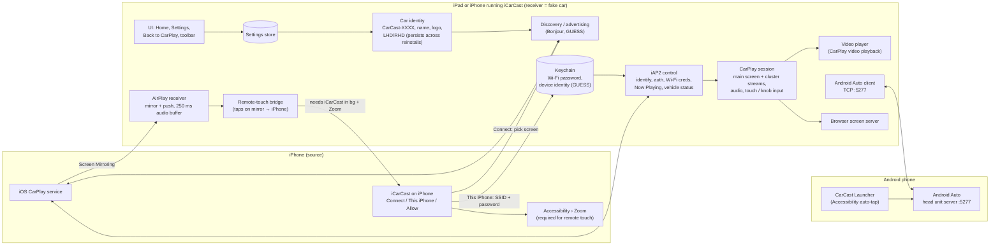

# Architecture: CarCast / iCarCast (rPlayAI/carcast-public)

## Scope and citation format

- **Target:** `https://github.com/rPlayAI/carcast-public` at commit `7c1e066374eb2a048a8528a3a5fe75d44fb80548` (2026-11-13), cloned read-only to `/home/user/rplayai/carcast-public`. The primary document is `docs/icarcast-user-guide.md` (283 lines).
- **There's no source code.** `README.md:20` says: "This repository is for releases, documentation and issues. The source code is not public." `LICENSE:4-5` says the same. The repo has 51 files: 9 markdown docs, 3 issue templates, a LICENSE, 35 screenshots and 3 demo media files. The apps themselves ship only as binaries (TestFlight, IPA/APK on GitHub Releases), and none of those are in the git tree.
- So "entry points" and "data flows" here are **reconstructed from documented behaviour**:
  - **CONFIRMED** means the docs state it (cited as `file:line`).
  - **GUESS** means it's inferred from the docs plus knowledge of how CarPlay, AirPlay and Android Auto work. Nothing was checked against a binary.
- Paths are relative to the repo root. The guide is abbreviated **UG** = `docs/icarcast-user-guide.md`; **NG** = `docs/ios-network-guide.md`.
- The previous analysis (Mac Activity Lab DMG) moved to `notes/mac-activity-lab/`. The two targets aren't related: nothing in either mentions the other.

- **Second evidence source (added later):** 11 screenshots the user took of the installed app and its TestFlight page, cited as `IMG_2138`…`IMG_2148`. They show build 1.0 (17), the in-app Settings and About screens, and the TestFlight release notes for builds 11-17. Claims cited to a screenshot are CONFIRMED by what's on screen. The user's Wi-Fi name and the app's Device ID are redacted below.

---

## 0. Who ships it, and what the installed build shows

| Fact | Evidence | Rating |
|---|---|---|
| The TestFlight publisher is **VMLite Corporation**, not "rPlayAI". The GitHub org and the App Store developer account are different names for the same product. The contact listed is a personal Gmail address, not a company domain. | IMG_2144 ("Deweloper: VMLite Corporation") | CONFIRMED |
| Build **1.0 (17)**, released **2 Nov 2026**, **19.2 MB**, TestFlight expiry **31 Jan 2027 02:25**. Builds 11-16 each expire 63-75 days out. | IMG_2144, IMG_2148, IMG_2147, IMG_2145 | CONFIRMED |
| The TestFlight description markets it neutrally ("turns your iPhone into car friendly display … navigation, music and phone calls") and doesn't mention CarPlay, AirPlay or Android Auto. That's probably to get through TestFlight review. | IMG_2144 | CONFIRMED (text); GUESS (motive) |
| VMLite plausibly being an established CarPlay/USB accessory vendor would back up README.md:11 ("code base proven in shipping CarPlay products"). | IMG_2144 + README.md:11 | GUESS |
| **Browser screen server:** HTTPS on **port 8081** and WebSocket on **port 8888**, both configurable. The user is told to join the iPhone's Personal Hotspot and open `https://172.20.10.1:8081`. No password or pairing is shown in the UI. | IMG_2140, IMG_2139, IMG_2138 | CONFIRMED (ports, URL); GUESS (no auth) |
| **Device ID** is formatted like a MAC address (`EA:B0:…:C4`, redacted). It's a locally administered unicast MAC (first octet `0xEA` has bit 1 set), i.e. a generated fake hardware ID. CarPlay identifies accessories by a MAC-style device ID, which is how "each device is its own car". | IMG_2142 | CONFIRMED (format); GUESS (purpose) |
| The car name suffix (`CarCast-9CB4`) **doesn't** match the Device ID's last bytes, so the name is generated separately. | IMG_2143, IMG_2142 | CONFIRMED |
| "Screen 1920 × 1014" reported in About on an **iPhone**, with Resolution = "Fit this screen". That's not the iPhone's native resolution, so the app scales its own screen to a 1920-wide car canvas. | IMG_2142 | CONFIRMED (value); GUESS (scaling) |
| Mode toggles as installed: CarPlay **on**, Android Auto **on**, CarPlay Ultra off, Browser screen off, AirPlay **off**, AirPlay push off (greyed out), **AirPlay control on**. | IMG_2138 | CONFIRMED (this device's state) |
| Home screen with no Wi-Fi: "Not on Wi-Fi. Tap This iPhone to use CarPlay here." The app offers This iPhone even on cellular. | IMG_2143 | CONFIRMED |

### Build history (TestFlight "What to test")

| Build | Change | Evidence |
|---|---|---|
| 11 | Portrait, night mode, driving position, CarPlay Ultra (iOS 26+), 100+ logos, Play sound here, **Wi-Fi for CarPlay** screen, "**This iPhone away from Wi-Fi uses your saved network with Personal Hotspot on**", Android Auto auto-discovery via launcher, Reset All Settings | IMG_2148 |
| 12 | Pinch-zoom on maps; video playback ("the screen device needs internet"); Stop-after-Connect fix | IMG_2147 |
| 13 | Video playback buffering fixes; **Android Auto now on by default** alongside CarPlay | IMG_2147 |
| 14 | AirPlay on the iPad (PiP/split/full), **control the iPhone from the iPad** (needs Zoom), mirror toolbar, AirPlay push, faster Connect, TarPlay for Tesla, "the iPhone's Personal Hotspot **can't** start CarPlay" | IMG_2146 |
| 16 | Audio-race crash fixes (5 + 3 reports from build 14); background crashes; Ultra force-disabled once; **This iPhone and Connect need iOS 17+** on the source iPhone (iOS 15/16 can still be the screen); first-mirror black-screen fix; layout fix | IMG_2145 |
| 17 | "Fixed: …" (truncated in the screenshot) | IMG_2144 |

---

## 1. What it does (3 sentences)

iCarCast is a closed-source iOS/iPadOS app that makes an iPad or iPhone pretend to be a **wireless CarPlay head unit** (a car's screen), so a real iPhone can run CarPlay onto it over Wi-Fi. It can also project CarPlay onto the same iPhone ("This iPhone"), act as an **AirPlay receiver** that shows a mirrored iPhone beside CarPlay (with remote touch control), and act as an experimental **Android Auto head unit** for an Android phone. CONFIRMED (UG:3-6, UG:12-19).

It's one client of a larger cross-platform "CarCast" CarPlay-receiver engine that also ships for macOS, Windows, Android and embedded Linux and is OEM-licensed to CarPlay box makers. CONFIRMED (README.md:9-11, README.md:32-38, README.md:150-164).

---

## 2. Entry points

No source exists, so these are the **user-facing and network-facing** entry points the docs describe.

| # | Entry point | Where documented | Notes |
|---|---|---|---|
| E1 | **Install / first launch**: TestFlight build, or sideloaded iPad IPA (receiver only) | UG:27-38 | CONFIRMED. The iPad IPA has no Connect or This iPhone (UG:37). Free-Apple-ID sideloads expire every 7 days (UG:32). |
| E2 | **Permission prompts on first launch**: Local Network, Location, Bluetooth | UG:40-44; NG:22-23 | CONFIRMED. Location is requested only so iOS reveals the Wi-Fi SSID (UG:43). |
| E3 | **Home screen**: Settings, Connect, This iPhone, Stop, Back to CarPlay, Android Auto | UG:46-57 | CONFIRMED. These are the app's UI entry points. |
| E4 | **Network listener: CarPlay receiver**, advertised as `CarCast-XXXX` | UG:48, UG:61-64; docs/ios.md:37 | CONFIRMED that it exists and how it's named. GUESS: Bonjour/mDNS advertisement of a wireless CarPlay accessory, plus iAP2 over Bluetooth for pairing and Wi-Fi credential exchange, and AirPlay-based video/audio streams (macos.md:17,23 lists "iAP2 control messages … and the AirPlay HTTP/RTSP requests"). |
| E5 | **Network listener: AirPlay receiver** (screen mirroring and "AirPlay push" of app video) | UG:107-142 | CONFIRMED that it exists; on by default (UG:109, UG:140). |
| E6 | **Outbound client: Android Auto** to the phone's head unit server on **TCP 5277** | UG:216-237 | CONFIRMED. iCarCast is the *client*; the Android phone listens (UG:226-233). |
| E7 | **Companion app: CarCast Launcher (Android APK)** | UG:224-228 | CONFIRMED. Uses an Android Accessibility service to tap "Start head unit server" for the user, and "announces the phone on the network" (GUESS: mDNS). |
| E8 | **iOS Shortcuts automation**: auto-open on charger or Bluetooth | UG:246-249; NG:105-109 | CONFIRMED. An external trigger; the app can't start itself. |
| E9 | **Browser screen** (iPhone): CarPlay shown in a web browser on another device | UG:156-157; IMG_2140, IMG_2138 | CONFIRMED: an embedded **HTTPS server on :8081** and **WebSocket on :8888** (both configurable), reached at `https://172.20.10.1:8081` over the iPhone's Personal Hotspot. GUESS: page and control over HTTPS, frames over the WebSocket, and a self-signed certificate (no domain to issue a real one for). No auth is shown. |
| E10 | **AirPlay control** toggle: taps on the mirror are forwarded to the source iPhone | IMG_2138, IMG_2146 | CONFIRMED. A separate mode switch from AirPlay; it was **on** on the user's device. |

---

## 3. Module diagram

All of this is a GUESS reconstructed from features. The module names are mine, not the vendor's.

---

## 4. The five main data flows

### Flow 1: Connect: iPhone → iPad as the CarPlay screen
1. On the iPad, iCarCast shows **Waiting for iPhone** and advertises itself as `CarCast-XXXX`. CONFIRMED (UG:61, UG:48). GUESS on the mechanism (mDNS).
2. Both devices must be on the **same Wi-Fi**; in the car that's a travel router, not the iPhone's Personal Hotspot. CONFIRMED (UG:62-63; NG:13-16).
3. On the iPhone, iCarCast **Connect** lists the CarCast screens on that Wi-Fi, and the user picks one. CONFIRMED (UG:64; NG:59-63). If none are found, Local Network permission or client isolation on public Wi-Fi is usually the cause. CONFIRMED (NG:65-70).
4. iOS treats the iPad as a new car. The first time, it asks **"Allow CarPlay While Locked?"**, which can't be answered on the CarPlay screen; the user answers in Settings › General › CarPlay. CONFIRMED (UG:71-72).
5. A CarPlay session starts. GUESS: iAP2 identification and authentication, then Wi-Fi/AirPlay-based streams. The video renders on the iPad, touch is sent back "as on a car screen", and audio plays on the iPad unless **Play sound here** is off. CONFIRMED (UG:66-67).
6. Settings such as the car name, logo, resolution and cluster are sent to iOS **at connection time**, which is why many changes need a restart or reconnect. CONFIRMED (UG:170, UG:213-214).
7. End: **Stop** on the iPhone, or car icon → **Stop** on the iPad. CONFIRMED (UG:69).

### Flow 2: This iPhone: CarPlay on the same device, and the Wi-Fi credential handoff
1. The user taps **This iPhone**, and CarPlay fills the screen. CONFIRMED (UG:76).
2. Precondition: the iPhone is **joined** to Wi-Fi. Personal Hotspot doesn't work, because iOS starts wireless CarPlay only on a joined network. CONFIRMED (UG:81-83).
3. Location must be allowed so the app can read the current **SSID**, and it won't start on an unknown network. CONFIRMED (NG:44-45).
4. **Credential handoff (the key flow):** iOS saves the current network *as the car's Wi-Fi, together with the password CarCast gives it*. So CarCast asks the user for the real password the first time, stores it **in the Keychain on that iPhone**, and doesn't ask again (long-press re-prompts). CONFIRMED (UG:86-88; NG:41-43). GUESS: CarCast plays the role a real car plays over iAP2 (the wireless CarPlay "Wi-Fi information" exchange): it hands iOS an SSID, password and security type for its "own" network, which here is really the user's existing network.
5. Pre-check: networks that can't be described to CarPlay without changing how the iPhone joins them (Enhanced Open/OWE, 802.1X enterprise with a username) are **refused** with *CarPlay can't start on "…"*. CONFIRMED (UG:96-99; NG:34). Open networks are "not confirmed yet". CONFIRMED (NG:33).
6. Watchdog: if CarPlay doesn't appear within about 10 s, it retries once automatically. CONFIRMED (UG:83-84; NG:39-40).
7. Audio always stays on the iPhone in this mode, and switching apps may end the session. CONFIRMED (UG:196-197; NG:46).

### Flow 3: AirPlay mirroring beside CarPlay, with remote touch back to the iPhone
1. With **Settings › Modes › AirPlay** on (the default), any iPhone, iPad or Mac on the network can mirror to `CarCast-XXXX` from Control Center › Screen Mirroring. "The first or second try may fail". CONFIRMED (UG:109-111).
2. **Alone**, the mirror fills the screen. **Beside CarPlay** (an iOS 27 capability), it's a movable, pinch-resizable window with PiP / split / full layouts and a toolbar placed per **Mirror toolbar**. CONFIRMED (UG:113-118).
3. Audio arrives with the mirror and is deliberately delayed by **about 250 ms** to smooth out jitter. CONFIRMED (UG:136-137).
4. **Remote touch (unusual):** taps on the mirror are delivered to the source iPhone, and the toolbar adds Home, App Switcher, volume, Siri and Lock. It needs (a) iCarCast running on the source iPhone, even in the background, (b) **Accessibility › Zoom turned on** there, and (c) per-screen authorization: automatic if this screen was started via Connect, otherwise "open iCarCast and tap **Allow**", which is remembered. CONFIRMED (UG:121-131).
   GUESS on the mechanism: the receiver forwards touches to the iCarCast app on the source iPhone, which delivers them to iOS as a pointer device (e.g. a Bluetooth HID pointer). iOS accepts external pointer input for this only with an accessibility feature on, hence Zoom. Either way it's a cross-device **input-injection channel**.
5. **AirPlay push:** apps' AirPlay video (e.g. YouTube) plays full screen on the receiver. Videos other than YouTube need internet **on the receiver**, so the receiver fetches the media URL itself. CONFIRMED (UG:140-142).

### Flow 4: Android Auto from an Android phone (experimental)
1. On the receiver, enable **Settings › Modes › Android Auto**; at least one of CarPlay or Android Auto always stays on. CONFIRMED (UG:220-221, UG:153).
2. On the phone, unlock **Android Auto developer settings** (tap the version 10×). CONFIRMED (UG:222-223).
3. Install the **CarCast Launcher APK** from GitHub Releases. It starts Android Auto's **head unit server** using an **Accessibility permission** that auto-taps the menu item, and announces the phone on the network. Without the launcher, it has to be started manually after each restart. CONFIRMED (UG:224-228).
4. Network: the same Wi-Fi, or the receiver on the **Android phone's hotspot**, which does work here. CONFIRMED (UG:229-230).
5. The receiver auto-discovers the phone, or the user enters its IP and **port 5277**, and the receiver connects as the head unit. Android Auto renders landscape, with touch and sound. CONFIRMED (UG:231-235). Troubleshooting points at the head unit server's state and the IP/port. CONFIRMED (UG:235-237, UG:265).

### Flow 5: Settings → car identity presented to the phone
1. **Car:** name (what iOS lists), logo (114 built-in brand logos per docs/releases.md:44, or a custom square image), logo label, LHD/RHD dock side. CONFIRMED (UG:160-170).
2. **Display:** resolution presets (Fit / 1920×720 / 800×480 / 1920×1080), video playback while parked, show touches, portrait, avoid notch, night mode, play sound here. CONFIRMED (UG:185-197).
3. **Instrument cluster:** a second CarPlay stream with no touch input; content is map, turn card or app-decided, with ETA and size options. CONFIRMED (UG:199-206). **CarPlay Ultra** uses 1920×720 screens and draws gauges with *simulated car data*. CONFIRMED (UG:154-155; README.md:96).
4. **Wi-Fi for CarPlay:** SSID (or "Use current Wi-Fi") and password, validated as 8-63 characters on Save, plus Forget. CONFIRMED (UG:172-183).
5. Most values are read by iOS **at connect time**, so the app offers **Quit CarCast** after changes; logo and label apply on the next connection without a restart. CONFIRMED (UG:170, UG:213-214).
6. **Identity persistence:** each device is "its own car" and "keeps that identity across reinstalls", so iOS asks to allow it only once. CONFIRMED (docs/ios.md:37; NG:82). GUESS: a stable ID and/or key pair kept in the Keychain, which survives app deletion on iOS.
7. **Reset All Settings** restores defaults, but iPhones that already paired keep the old car. CONFIRMED (UG:210-211).

---

## 5. Anything weird

| # | Finding | Evidence | Rating |
|---|---|---|---|
| W1 | **Shipped bug that corrupted users' saved Wi-Fi networks.** TestFlight builds 1-4 "could change a saved Wi-Fi network" (typically café or store Wi-Fi) when This iPhone was used. Afterwards the iPhone can't join it, asks for a password the network doesn't have, and *Forget This Network* doesn't help until the user also does *Forget This Car*. The vendor says builds 6+ "never change a network". This follows from Flow 2: the app hands iOS Wi-Fi credentials that overwrite the system's saved profile for that SSID. | UG:267-280; NG:84-95 | CONFIRMED (symptom and fix); GUESS (root cause) |
| W2 | **The app handles the user's real Wi-Fi password and pushes it into the iOS system Wi-Fi config.** It's stored in the Keychain "on this iPhone only". A wrong value "would replace your real one". This is a powerful side effect for a third-party app. | UG:86-88, UG:182-183; NG:41-43 | CONFIRMED |
| W3 | **The vendor contradicts itself on Personal Hotspot**, across four sources. (a) The release notes say iOS 1.0 works over Personal Hotspot. (b) Build 11 says "This iPhone away from Wi-Fi uses your saved network with Personal Hotspot on". (c) Build 17's in-app Settings text still says the CarPlay network is used "away from it with Personal Hotspot on", and the Browser screen *requires* the hotspot. (d) Build 14 says "the iPhone's Personal Hotspot can't start CarPlay", and the user guide says it doesn't work. GUESS on the reconciliation: (b) was an attempt to make This iPhone work off-Wi-Fi by advertising the *saved* SSID while the hotspot is up. It didn't work reliably and was walked back in (d), but the UI text wasn't updated. The hotspot is still used for the Browser screen. | docs/releases.md:54; IMG_2148; IMG_2140; IMG_2146; UG:22-23, UG:82, UG:243 | CONFIRMED (contradiction); GUESS (history) |
| W4 | **Cross-device input injection via Accessibility Zoom.** A receiver on the LAN can drive the source iPhone (taps, Home, App Switcher, Siri, Lock). Authorization is per screen and remembered, and is automatic for screens started with Connect. On a shared network, a spoofed `CarCast-XXXX` name is a phishing and hijack angle. The docs don't describe how screens are authenticated. | UG:121-131 | CONFIRMED (capability); GUESS (risk) |
| W5 | **Android Auto head unit server exposed on the LAN without auth.** Android Auto's developer-mode head unit server listens on TCP 5277; anyone on the same Wi-Fi or hotspot can connect as a "car". The docs suggest using the phone's hotspot or home Wi-Fi but don't warn about this. | UG:222-233, UG:265 | CONFIRMED (port and dev mode); GUESS (exposure) |
| W6 | **Android Accessibility service used to auto-click another app's UI** (the launcher taps "Start head unit server"). It's disclosed, but it's the pattern Google Play restricts. The launcher is distributed only as an APK. | UG:226-228 | CONFIRMED |
| W7 | **Device identity survives reinstalls.** Useful for pairing, but it's a persistent device identifier the user can't reset by deleting the app. Reset All Settings doesn't help for phones that already paired. | docs/ios.md:37; NG:82; UG:210-211 | CONFIRMED (behaviour); GUESS (Keychain) |
| W8 | **Emulating an Apple CarPlay head unit from a TestFlight / sideloaded app.** Real CarPlay accessories go through Apple's MFi program and authentication (the Protocol Inspector shows an "authentication" phase, macos.md:23). The README claims a "code base proven in shipping CarPlay products". How a non-MFi iPad app passes CarPlay auth isn't explained. That's a compliance and longevity risk: Apple could break it in an iOS update, as iOS 27.2 did for direct video rendering (README.md:62, README.md:70). | README.md:11, README.md:20; macos.md:17-23 | GUESS |
| W9 | **Third-party car-brand trademarks bundled.** The default logo is **LEXUS**, and 114 brand logos ship in the app. | UG:103; docs/releases.md:44; README.md:57 | CONFIRMED (bundled); GUESS (licensing) |
| W10 | **Location permission requested only to read the SSID.** It's legitimate: iOS gates SSID access behind location. But users see a location prompt for a "screen" app. | UG:43; NG:23, NG:44-45 | CONFIRMED |
| W11 | **Receiver fetches pushed-video URLs itself** when it's online ("Other apps' videos need internet on this screen"). The receiver makes outbound requests to URLs supplied by any AirPlay sender on the LAN. | UG:141-142; README.md:80 | CONFIRMED (behaviour); GUESS (risk) |
| W12 | **Browser screen = an HTTPS server (:8081) plus a WebSocket server (:8888) on the iPhone**, streaming the live CarPlay screen (maps, messages, calls) to any browser that reaches it. No password or pairing appears in the settings. Anyone else on the same hotspot or network who knows the URL could probably watch, and maybe send touches. | UG:156-157; IMG_2140, IMG_2138 | CONFIRMED (server and ports); GUESS (no auth, exposure) |
| W16 | **Docs are behind the shipped app.** The guide says Android Auto is "off by default" (UG:19, UG:218), but since build 13 it's **on by default** (IMG_2147, IMG_2138). The guide doesn't mention the **iOS 17+ requirement** for This iPhone and Connect added in build 16 (IMG_2145); it still says iOS 15+ (UG:21). | UG:19, :21, :218 vs IMG_2147, IMG_2145 | CONFIRMED |
| W17 | **Publisher-name split.** The GitHub org is "rPlayAI", the TestFlight developer is "VMLite Corporation", and the contact is a personal Gmail address. The TestFlight description avoids naming CarPlay. Together with W8 (emulating an MFi head unit), this looks like the app is presented as a generic "car display" to get past Apple review. | IMG_2144; README.md | CONFIRMED (facts); GUESS (motive) |
| W18 | **Android Auto on by default** means the receiver may try to connect to Android phones' head unit servers without the user asking for that mode. | IMG_2147 | CONFIRMED (default); GUESS (impact) |
| W13 | **Time-bombed Android builds**, which stop working 90 days after build. Unrelated to iCarCast but part of the same product. | README.md:124; docs/releases.md:20, :27, :38, :48 | CONFIRMED |
| W14 | **Hardcoded secrets:** none. The only embedded identifier is the public TestFlight invite `mgpX2urq`, which is meant to be shared. Port 5277 is Android Auto's standard. | UG:29; README.md:3 | CONFIRMED |
| W15 | **Dead or stale content:** `docs/ios.md:52` says to sideload "when one is posted", while UG:31-35 and releases.md already link the posted IPAs. Small doc drift. | docs/ios.md:52 vs UG:31-35 | CONFIRMED |
